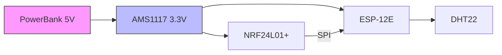
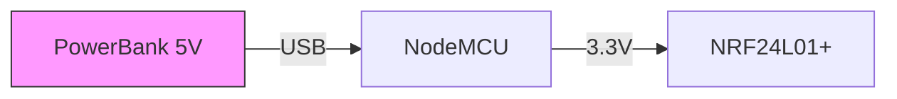
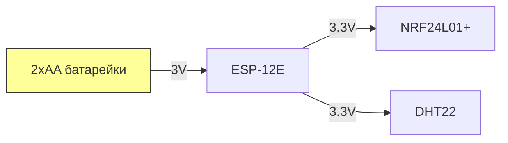
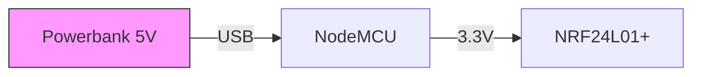
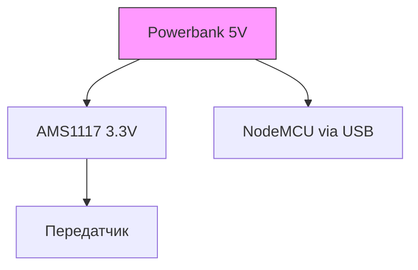

# 🛠 Полная схема подключения

## 📡 **Для передатчика (ESP-12E + DHT22)**


### 🔌 **Распиновка:**
| NRF24L01+ | ESP-12E | DHT22       | Примечания                  |
|-----------|---------|-------------|-----------------------------|
| VCC       | 3.3V    | -           | Через конденсатор 10 мкФ    |
| GND       | GND     | GND         | Общая земля                 |
| CE        | D2      | -           |                             |
| CSN       | D1      | -           |                             |
| SCK       | D5      | -           | SPI Clock                   |
| MOSI      | D7      | -           | Master Out Slave In         |
| MISO      | D6      | -           | Master In Slave Out         |
| -         | D4      | DATA        | Подтяжка 10K к 3.3V         |

### 💡 **Примечания:**
1. **Питание NRF24L01+**:
   - Только **3.3V**! 5V убьёт модуль.
   - Обязателен конденсатор **10 мкФ** между VCC и GND.
2. **DHT22**:
   - Подключите **DATA** к D4.
   - Подтяжка 10K не обязательна (в DHT22 есть встроенный резистор).

---

## 📻 **Для приемника (NodeMCU)**


### 🔌 **Распиновка:**
| NRF24L01+ | NodeMCU | Примечания                  |
|-----------|---------|-----------------------------|
| VCC       | 3.3V    | + конденсатор 10 мкФ        |
| GND       | GND     |                             |
| CE        | D2      |                             |
| CSN       | D1      |                             |
| SCK       | D5      |                             |
| MOSI      | D7      |                             |
| MISO      | D6      |                             |

### 💡 **Примечания:**
1. NodeMCU можно питать через **USB** (5V) — встроенный стабилизатор преобразует в 3.3V.
2. Для стабильной связи:
   - Используйте **одинаковые каналы** (например, `setChannel(5)`).
   - Задайте **одинаковый адрес** трубы (`0xF0F0F0F0E1LL`).

---

## ⚠️ **Критические моменты**
1. **Не перепутайте питание**:
   - NRF24L01+ **только 3.3V**.
   - ESP-12E тоже требует 3.3V (но NodeMCU преобразует USB 5V сам).
2. **SPI-пины на ESP8266**:
   ```
   SCK  → D5
   MOSI → D7
   MISO → D6
   ```
3. **Дальность связи**:
   - До 100 м (в идеальных условиях с PA/LNA модулем).
   - Антенну не загибать!

---

## 📊 **Проверка работоспособности**
1. **Передатчик**:
   ```cpp
   Serial.print("Отправлено: ");
   Serial.print(data.temperature);
   Serial.println("°C");
   ```
2. **Приемник**:
   ```cpp
   if (radio.available()) {
     radio.read(&data, sizeof(data));
     Serial.println("Данные получены!");
   }
   ```

---

## 🔧 **Если не работает**
1. Проверьте **мультиметром**:
   - 3.3V на VCC NRF24L01+.
   - Отсутствие КЗ между контактами.
2. Перезагрузите ESP.
3. Попробуйте другой **канал** (от 0 до 125).

---

> 💬 **Совет**: Для первого теста сократите расстояние между модулями до 1 метра. Убедитесь, что адреса и каналы совпадают!
``` 
Отлично! Начнём с **простого и дешёвого варианта на батарейках**. Вот детальная инструкция:

---

### 🔋 **1. Питание передатчика (ESP-12E + NRF24L01+ + DHT22)**
#### **Что нужно:**
- **2 пальчиковые батарейки AA (1.5V каждая)** → **3V в сумме**  
  _Или 1 батарейка CR2032 (3V, но малой ёмкости)_  
- **Конденсатор 10 мкФ** (обязательно для NRF24L01+)  

#### **Схема подключения:**


#### **Как подключить:**
1. Соедините батарейки **последовательно** (+ к –), чтобы получить **3V**.  
2. **Плюс (3V)** → **VCC ESP-12E** (он работает от 2.5V–3.6V).  
3. **Минус** → **GND ESP-12E**.  
4. От **пина 3.3V ESP-12E** запитайте:  
   - NRF24L01+ (через конденсатор 10 мкФ).  
   - DHT22.  

#### **Важно!**  
- ESP-12E может **нестабильно работать** при падении напряжения ниже 3V.  
- NRF24L01+ **не включится**, если напряжение упадёт ниже 2.7V.  

---

### 🔌 **2. Питание приемника (NodeMCU + NRF24L01+)**
#### **Что нужно:**
- **Powerbank 5V** (или блок питания от USB) → **питание через USB-порт NodeMCU**.  

#### **Схема подключения:**


#### **Как подключить:**
1. Подключите Powerbank к **USB-порту NodeMCU**.  
2. От **пина 3.3V NodeMCU** запитайте NRF24L01+ (через конденсатор 10 мкФ).  

---

### ⚡ **3. Альтернатива: Один Powerbank на оба устройства**  
Если передатчик и приемник рядом:  


#### **Что понадобится:**
- **AMS1117 3.3V** (для преобразования 5V → 3.3V передатчика).  
- **Разветвитель USB** (чтобы подключить и NodeMCU, и AMS1117).  

---

### 📊 **Ожидаемое время работы от батареек**  
| Источник          | Передатчик (ESP-12E) | Приемник (NodeMCU) |  
|-------------------|----------------------|--------------------|  
| 2×AA (3000 мАч)   | ~12–24 часа          | Не применяется     |  
| CR2032 (220 мАч)  | ~2–4 часа            | Не применяется     |  
| Powerbank 10000 мАч | –                    | ~24–48 часов       |  

**Совет**: Для продления времени работы передатчика используйте **режим глубокого сна** (`ESP.deepSleep()` между передачами).  

---

### ❌ **Чего нельзя делать**  
1. **Подавать на ESP-12E больше 3.6V** — сгорит.  
2. **Игнорировать конденсатор 10 мкФ** на NRF24L01+ — будут сбои связи.  
3. **Использовать батарейки для приемника** — NodeMCU требует 5V.  

---

### 🔧 **Проверка работоспособности**  
1. **Передатчик**:  
   - Замерьте напряжение на батарейках — должно быть **≥2.8V**.  
   - В мониторе порта должны быть сообщения:  
     ```  
     Отправлено: Temp=25.3°C  
     ```  

2. **Приемник**:  
   - Если данные не приходят, проверьте:  
     - Совпадают ли **каналы** (например, `setChannel(5)`).  
     - Правильно ли подключён **конденсатор** к NRF24L01+.  

---

### 💡 **Советы для теста**  
- Сначала проверьте систему **на минимальном расстоянии** (1–2 метра).  
- Если связь нестабильна, замените батарейки на **свежие**.  
